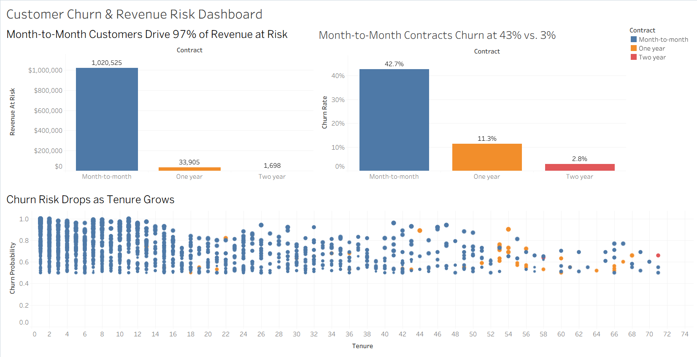

# Customer Churn & Revenue Risk Pipeline

End-to-end pipeline that loads 7,043 telecom customers into SQLite, scores each customer's churn risk with a Random Forest model, and estimates how much annual revenue is at risk.

**Tools:** Python (pandas, scikit-learn), SQLite, SQL, Tableau
**Data:** [IBM Telco Customer Churn dataset](https://www.kaggle.com/datasets/blastchar/telco-customer-churn) (7,043 customers)



## Results

- **$1.06M** in expected annual revenue at risk across **1,562** customers flagged as likely to churn
- **97%** of that risk ($1.02M) comes from month-to-month customers
- Month-to-month contracts churn at **42.7%**, compared with **11.3%** for one-year and **2.8%** for two-year contracts
- Model accuracy: **76.8%** (5-fold cross-validated)

| Contract | Customers | Churn rate | Flagged high risk | Revenue at risk |
|---|---|---|---|---|
| Month-to-month | 3,875 | 42.7% | 1,515 | $1,020,525 |
| One year | 1,473 | 11.3% | 45 | $33,905 |
| Two year | 1,695 | 2.8% | 2 | $1,698 |

**Takeaway:** moving month-to-month customers onto annual contracts is the biggest retention lever. A targeted offer to the 1,515 flagged month-to-month customers covers almost all of the revenue at risk.

## How it works

1. `ingest.py` cleans the CSV and loads it into a SQLite database (`churn.db`)
2. `predict.py` trains a Random Forest on tenure, charges, contract type, gender, and senior status, then scores every customer
3. `sql_analysis.sql` breaks down churn and revenue at risk by contract and lists the highest-risk customers
4. `predict.py` also exports `churn_export.csv`, which feeds the Tableau dashboard

**Revenue at risk** = monthly charges × 12 × churn probability, summed over customers the model flags (probability ≥ 50%).

## Notes on the model

- Scores use 5-fold cross-validation, so each customer is scored by a model that was trained without them. Scoring customers the model trained on inflates accuracy (an earlier version showed 95% this way, versus about 77% on unseen customers).
- The model catches 48% of actual churners (recall) at 57% precision. A lower probability threshold would catch more churners at the cost of more false alarms.
- 11 brand-new customers (tenure 0) have no TotalCharges value and are set to 0.

## Files

| File | Description |
|---|---|
| `ingest.py` | Cleans the CSV and loads it into SQLite |
| `predict.py` | Trains and cross-validates the model, saves predictions, exports the CSV |
| `sql_analysis.sql` | Churn and revenue-at-risk analysis queries |
| `telecom_churn.csv` | Source data |
| `Customer_Churn__Revenue_Risk_Dashboard.twbx` | Tableau dashboard |
| `requirements.txt` | Python packages |

## How to run

```
pip install -r requirements.txt
python ingest.py
python predict.py
```

Then open the `.twbx` file in Tableau and refresh the data source.
